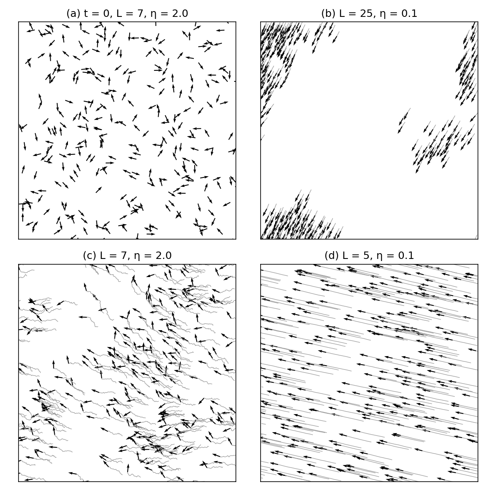

# Vicsek model: onset of collective motion

Reproduction of T. Vicsek, A. Czirók, E. Ben-Jacob, I. Cohen, O. Shochet (1995).
*Novel type of phase transition in a system of self-driven particles.* Phys. Rev.
Lett. 75:1226. [arXiv cond-mat/0611743](https://arxiv.org/abs/cond-mat/0611743)

Particles move at constant speed and, at every step, take the mean direction of their
neighbours plus random noise. Below a critical noise level the whole system moves in
one spontaneously chosen direction. The paper reports this ordering transition, its
dependence on noise and density, and two critical exponents.



## Model

As stated in the paper, with no additional assumptions:

| Element | Paper | Here ([vicsek.py](vicsek.py)) |
|---|---|---|
| Box | square of side L, periodic | same |
| Speed, radius, time step | v = 0.03, r = 1, Δt = 1 | same |
| Direction update | mean direction (atan of mean sin / mean cos) of all particles within r, itself included, plus noise uniform in [−η/2, η/2] (Eq. 2) | same |
| Position update | x(t+1) = x(t) + v(t)Δt (Eq. 1), the "backward" update | same |
| Initial state | random positions and directions | same |
| Order parameter | v_a = \|Σ v_i\| / (N v) (Eq. 3) | same |

**Not stated in the paper:** the run length and the measurement window. Each run here
lasts 12,000 steps and records v_a in blocks of 500 steps. v_a is measured over the
second half of the run unless stated otherwise. Each point is averaged over 5 runs
(the paper used 5 runs for its error estimates near the transition), or over 2 runs for
N = 4000 and 10000, whose order parameter varies little between runs.

**Inconsistency in the paper.** The text and the caption of Fig. 3 give the density of
Figs. 2a and 3a as ρ = 0.4, but all (N, L) pairs of Fig. 2a give ρ = N/L² = 4. ρ = 4
is used.

## Results

Pending.

## Running

```bash
./run_experiments.py   # Figs. 2a and 2b: 970 runs, about 25 min on 16 cores
./analyze.py           # tables, results/fig2_steps6000-12000.png, results/fig2a_windows.png
./snapshots.py         # results/fig1.png and the animation results/vicsek.mp4
```

Requires Python 3 with NumPy, SciPy and Matplotlib (ffmpeg for the animation).
