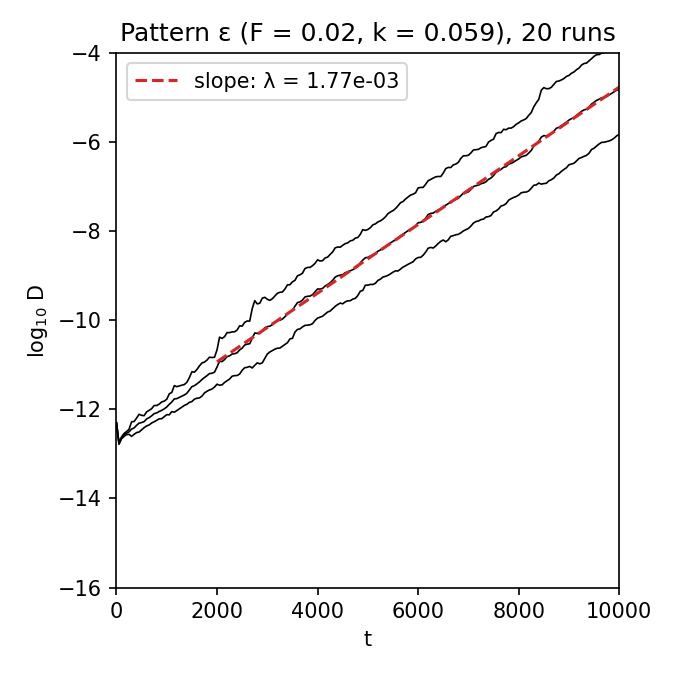

# Gray-Scott patterns

Reproduction of J. E. Pearson (1993). *Complex patterns in a simple system.* Science
261:189–192. [arXiv patt-sol/9304003](https://arxiv.org/abs/patt-sol/9304003)

Two chemicals react and diffuse. U is fed in, V consumes U to make more of itself, and
V decays:

  ∂U/∂t = D_u ∇²U − UV² + F(1 − U)
  ∂V/∂t = D_v ∇²V + UV² − (F + k)V

Pearson scanned the feed rate F and the removal rate k from a single square
disturbance. He found twelve kinds of pattern, which he labelled with Greek letters.
Among them are spots that grow until they split in two (self-replication without any
replication machinery) and a chaotic regime in which spots are born and die.

## Model

As stated in the paper:

| | Paper | Here ([grayscott.py](grayscott.py)) |
|---|---|---|
| Domain | 2.5 × 2.5, periodic | same |
| Grid | 256 × 256 | same |
| D_u, D_v | 2 × 10⁻⁵, 10⁻⁵ | same |
| Integration | forward Euler, Δt = 1, finite-difference Laplacian | same, five-point Laplacian |
| Initial state | U = 1, V = 0; the central 20 × 20 points U = 1/2, V = 1/4; ±1 % random noise | same; noise taken as multiplicative |
| Run length | 200,000 steps | same |

The paper says neither which Laplacian stencil it used nor whether the ±1 % noise is
relative or absolute. The five-point stencil and relative noise are the plainest
readings.

## Results

### Fig. 1: the uniform states

The phase diagram of the reaction kinetics follows from the equations without
simulation.

- **Saddle-node line.** Nontrivial uniform states exist for 4(F + k)² ≤ F.
- **Hopf line.** The blue state loses stability where (F + k)² = F√k, which is where
  V² = k on that state.

[analyze.py](analyze.py) draws both curves. They match the paper's Fig. 1 and the
lines on its Fig. 3: they meet at F = k = 1/16, and pass through F ≈ 0.005 (saddle-node)
and F ≈ 0.009 (Hopf) at k = 0.03.


### Fig. 6: chaos in pattern ε

The paper evolves pattern ε (F = 0.02, k = 0.059) for 20,000 steps, perturbs a copy by
about 10⁻¹² and follows the mean difference D(t) of U. Here 20 independent runs give:

| | Paper | Here |
|---|---|---|
| Largest Lyapunov exponent | "on the order of 1.5 × 10⁻³" (text); about 1.7 × 10⁻³ (slope of its Fig. 6) | 1.77 × 10⁻³ ± 0.29 × 10⁻³ |
| Lyapunov time | 660 steps | 564 steps |



Reproduced. The exponent agrees with the slope of the paper's own figure. The value in
its text is a rounded "order of" estimate.

### Fig. 3: the map of patterns

PENDING_MAP

## Running

```bash
./run_map.py       # 63 points of Fig. 3, 200,000 steps each (hours on 8 cores)
./lyapunov.py      # Fig. 6, about 10 min
./analyze.py       # tables, Figs. 1-3
./view.py kappa    # watch one pattern live (any Greek letter, or --F and --k)
```

Requires Python 3 with NumPy, SciPy and Matplotlib (OpenCV for the live view).
